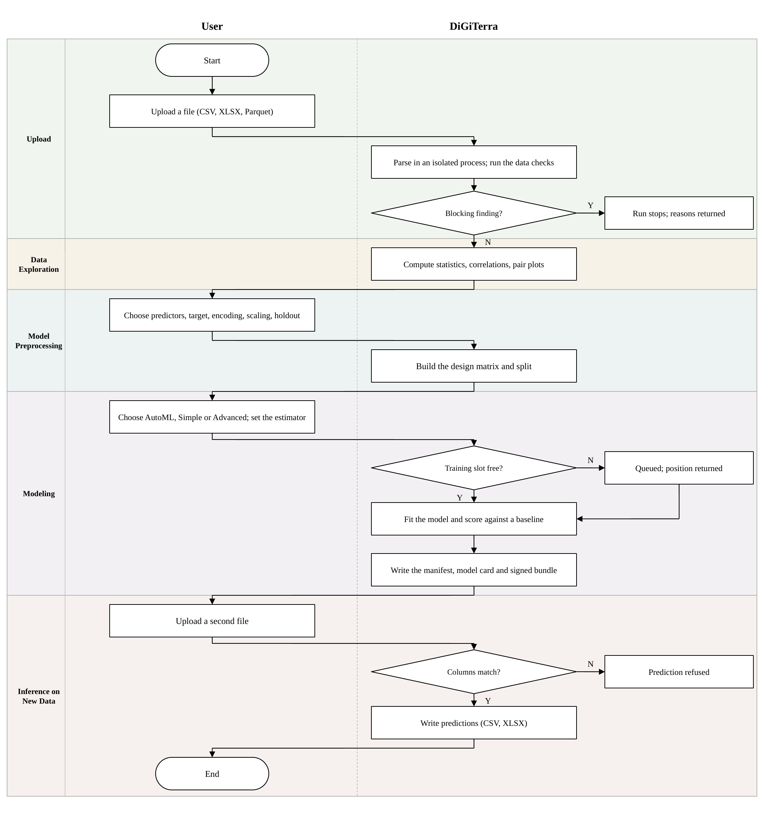

# Summary

DiGiTerra is a graphical interface for data exploration and machine learning on tabular data, written for researchers who need a model but do not write code. A user uploads a CSV, Excel, or Parquet file, examines it through descriptive statistics and figures, selects columns, applies preprocessing, and trains a regression, classification, or clustering model. The application registers 67 trainable estimators from scikit-learn, 32 for regression, 23 for classification, and 12 for clustering, and every hyperparameter an estimator exposes remains editable. A fitted model can be applied to new rows, and each run writes a record carrying the input hash, random seed, requested settings, metrics, and installed package versions, so a result can be reproduced or audited after the session ends. DiGiTerra runs in a browser or as a desktop application on macOS, Windows, and Linux, and the source is released under the MIT license.

# Statement of need

Machine learning methods are widely adopted in scientific research [@kapoor2024reforms], yet a research group rarely holds both the data and the expertise to apply the right method, and whether experimentalists can use these algorithms independently is still an open question [@greener2022guide]. Interfaces that require no code can lower that barrier, but the existing options force a trade between cost, approachability, and control. A second gap is provenance: reporting guidance for machine-learning-based science asks authors to describe the source of the data, the train-test split or cross-validation folds, and every model trained [@kapoor2024reforms]. An interface that trains a model without recording those facts leaves its user unable to meet that standard.

DiGiTerra is a free, open-source interface that needs no node graph, no command line, and no prior machine learning knowledge, keeps every hyperparameter editable, and writes a machine-readable record of each run.

# State of the field

Eleven no-code and low-code interfaces were read from their documentation on 24 September 2026 (`docs/competitor_survey_2026-09-24.txt`). Amazon SageMaker Canvas [@aws2025canvas] and Azure Machine Learning [@microsoft2025azureml] bill for compute and run only in the vendor's cloud, as does Vertex AI. RapidMiner AI Studio is now a Siemens product [@siemens2026rapidminer]. H2O-3 reaches its models through the Flow interface [@h2o2026h2o3], which its documentation marks as deprecated. KNIME composes an analysis from processing nodes [@fillbrunn2017knime] and Orange pairs a scripting library with a visual programming platform [@demsar2013orange]; in both, the user designs the graph before a model is fitted. Interface design decides whether such a system works for a non-expert at all [@dudley2018review]; a workbench built for the domain specialist goes back to the first Weka [@holmes1994weka].

Three gaps recur. Only RapidMiner and DataRobot offer a distinct novice path and expert path. The cloud AutoML products do not let the user edit hyperparameters, and the desktop tools that do (Orange, KNIME, Weka, JASP) raise no data-quality findings before training beyond missing-value counts. No product read states that its run record includes a hash of the input data or the installed package versions, and among the free tools jamovi alone documents screen reader support.

# Software design

Preprocessing covers missing values and zeros, one-hot encoding of text columns, stratified, time-ordered and grouped holdouts, and scaling. When no model is named on the AutoML page, a candidate set is scored by cross-validation on the same folds over several seeds and the best is trained; the fold scores are drawn as one box per candidate, so a winner separated from the runner-up by less than the fold-to-fold spread is shown as such. On the inference page a figure sets the spread of every predictor in the training rows against the rows being predicted.

Before a run starts, data checks look for a feature that duplicates the target, a categorical column that maps one to one onto the class, constant and identifier columns, heavy missingness, duplicate rows, class imbalance, and too few rows for the split. A blocking finding stops the run; a user who overrides one must write a justification, and the run is then labeled as not valid for decision use. Each fitted model is scored against a baseline on the same validation rows.

The interface ships in two forms on the same routes. The classic page holds Simple, Advanced and AutoML modes. The guided page (`/guided`) is four steps, one on screen at a time, with a plain-language explanation on every control, hyperparameter and metric, and a Full choice that opens a hyperparameter table filled from the estimator's own signature, so names and defaults cannot drift from scikit-learn. The page is built to WCAG 2.2 AA, and a Chromium test runs axe-core under the A and AA rule sets with no serious violation allowed; `docs/ACCESSIBILITY.md` states what is checked and what is not claimed.

Every run writes a manifest and a model card. The manifest records the SHA-256 of the uploaded bytes, the request as submitted, the seed, the estimator and its parameters, preprocessing and split, metrics, baseline, data-check findings, and every installed package version. Models are stored with skops rather than pickle, so loading builds only allowlisted types, and each installation signs its bundles with an HMAC-SHA256 key that import verifies. Command-line scripts score and rerun a bundle without the interface.

The application is written in Python 3.11 and 3.12 [@psf2026python], with HTML [@whatwg2026html] and JavaScript [@ecma2024ecmascript] on the front end, and Flask 3.1.3 [@pallets2026flask] with Werkzeug 3.1.8 [@pallets2026werkzeug] serves it. Scikit-learn 1.9.0 [@pedregosa2011sklearn] supplies the estimators, preprocessing steps, and metrics; NumPy 1.26.4 [@harris2020numpy], pandas 2.3.3 [@mckinney2010pandas], and SciPy 1.17.1 [@virtanen2020scipy] handle arrays, frames, and statistics; matplotlib 3.11.1 [@hunter2007matplotlib] and seaborn 0.13.2 [@waskom2021seaborn] draw the figures; SHAP 0.49.1 [@lundberg2017shap] produces the model explanations; skops 0.14.0 [@skops2026] writes the artifacts. A Flask application was chosen over a desktop toolkit so that one code base serves a researcher's own machine and a hosted instance behind an institutional proxy. Uploaded files are parsed in a separate process under a memory ceiling and a wall clock.

# Verification

Three records in the repository state what the software does with numbers. A sweep trains every registered estimator on a matching example dataset through the function the web route calls, with the defaults an empty form submits: 67 of 69 entries train. A second script writes and reloads every estimator through the bundle format and compares predictions: 66 of 67 round-trip identically.

The third record is a black-box differential test. Shuffled copies of the iris and diabetes example files were split once into fixed train and test halves (120 and 30 rows; 353 and 89 rows) and run with the same predictors and settings in DiGiTerra, Orange 3.39.0, RapidMiner AI Studio 2026.0.1 and R 4.5.1, each twice, with a plain scikit-learn script as the arbiter. For ordinary least squares the intercept, the ten coefficients and all 89 test predictions agree across the four programs at six significant figures; for k-nearest neighbors all 30 predicted classes agree; for logistic regression DiGiTerra reproduces scikit-learn's class probabilities exactly. The plan, case files, every program's saved output and the comparison script ship in `docs/differential_test_E1/`. The test found three defects in the version under test, among them a hyperparameter typed on the Advanced form that never reached nineteen classifiers. An adversarial review of the routes, the pipeline and the browser side found a further set, each reproduced before it was fixed and each now under a regression test; two changed reported numbers (mean and median fills had included the target column; binary ROC AUC had been scored against string labels rather than the estimator's class order), and the changelog lists the rest.

A unit and integration suite runs on Linux and macOS across both supported Python versions. Ten example datasets ship with the application, among them the iris measurements of @fisher1936iris and the Palmer Archipelago penguin data of @gorman2014penguins.

# Research impact statement

The Department of Energy's National Energy Technology Laboratory hosts DiGiTerra on its internal Energy Data eXchange platform (EDX) as a laboratory-approved executable for staff who model geochemical and materials data without writing code. EDX is not reachable from outside the laboratory, so the deployment cannot be linked here; the Phase 2 application under which it was accepted into the EDX Incubator ships in the repository (`docs/EDX_Incubator_Phase2_Application_Answers.pdf`) and records the hosting terms and the initial user group. The hosted copy is the same code as the public release, so a result produced inside the laboratory and one produced from the public repository carry the same run record.

# Author contributions

Paige E. DiGirolamo and Rowan R. Terra contributed to this project equally.

# Acknowledgements

Appreciation is extended to the Department of Energy, National Energy Technology Laboratory for agreeing to host DiGiTerra on their internal Energy Data eXchange platform (EDX). This research was supported in part by an appointment at the National Energy Technology Laboratory (NETL) through the Professional Internship Program (PIP), sponsored by the U.S. Department of Energy and administered by the U.S. Department of Energy Oak Ridge Institute for Science and Education (ORISE).

This article was prepared as an account of research sponsored by an agency of the United States Government. Neither the United States Government nor any agency thereof, nor any of their employees, makes any warranty, express or implied, or assumes any legal liability or responsibility for the accuracy, completeness, or usefulness of any information, apparatus, product, or process disclosed, or represents that its use would not infringe privately owned rights. Reference therein to any specific commercial product, process, or service by trade name, trademark, manufacturer, or otherwise does not necessarily constitute or imply its endorsement, recommendation, or favoring by the United States Government or any agency thereof. The views and opinions of authors expressed therein do not necessarily state or reflect those of the United States Government or any agency thereof.

# References
